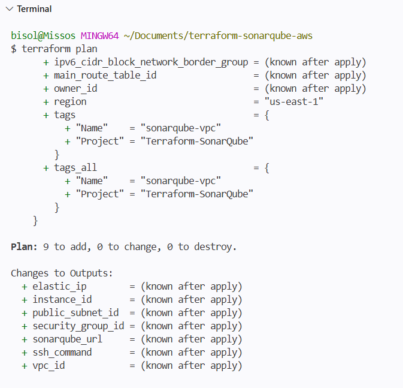
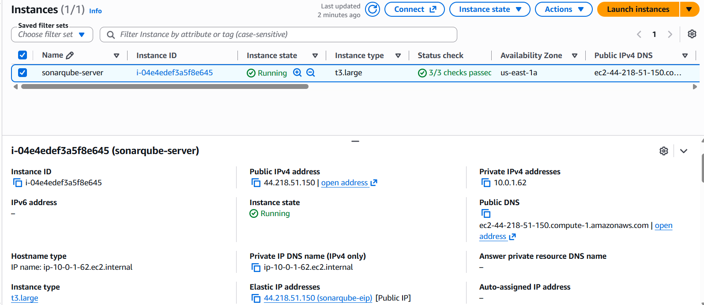
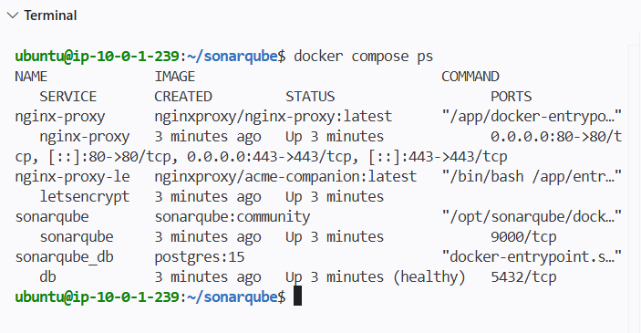
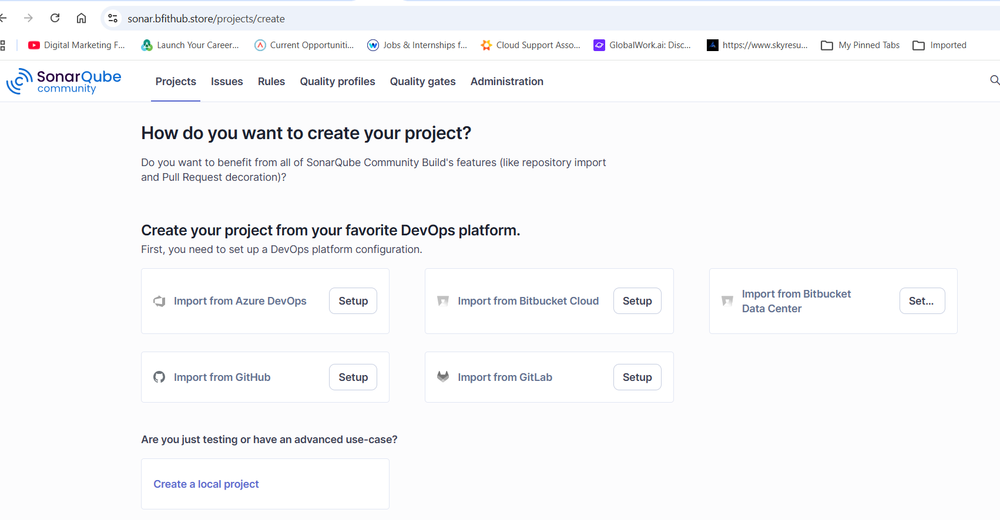
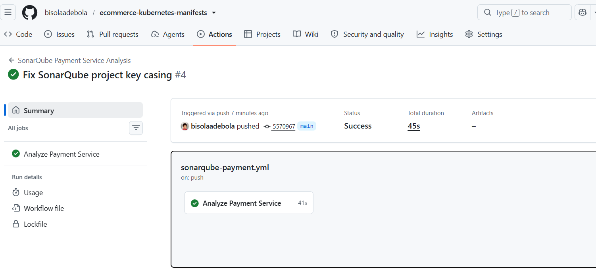

# Terraform SonarQube AWS DevSecOps Project

## Overview

This project demonstrates deploying a self-hosted SonarQube Community Edition server on AWS EC2 using Terraform and Docker Compose, then integrating automated code analysis with GitHub Actions.

The project provided hands-on experience with Infrastructure as Code (IaC), containerized services, HTTPS configuration, CI/CD integration, and automated code-quality analysis.

## Technologies Used

- AWS EC2
- Terraform
- Docker and Docker Compose
- SonarQube Community Edition
- PostgreSQL
- GitHub Actions
- GitHub Secrets
- Linux
- DNS and HTTPS

## Architecture and Workflow

1. Defined AWS infrastructure using Terraform.
2. Provisioned an Ubuntu EC2 instance and supporting networking resources.
3. Deployed SonarQube and PostgreSQL using Docker Compose.
4. Configured a custom domain and HTTPS access.
5. Connected the Payment Service source code to SonarQube analysis.
6. Configured GitHub Actions secrets for SonarQube authentication.
7. Automated code analysis for configured GitHub events.
8. Reviewed the workflow execution and code-quality analysis process.

## Project Screenshots

These five screenshots highlight the key stages of the project, from infrastructure provisioning to automated code analysis.

### 1. Terraform Infrastructure Plan

Terraform plan output reviewed before applying infrastructure changes.

### 2. AWS EC2 Instance and Storage

The AWS EC2 environment and storage used to host the SonarQube server before cleanup.

### 3. SonarQube and PostgreSQL Deployment

SonarQube, PostgreSQL, and the Nginx proxy running as containerized services using Docker Compose.

### 4. Secure SonarQube HTTPS Access

The SonarQube dashboard accessed through the configured custom domain over HTTPS.

### 5. GitHub Actions — Successful SonarQube Scan

The GitHub Actions workflow completed successfully, demonstrating automated integration between the Payment Service repository and SonarQube.

Additional implementation screenshots are available in the [`screenshots/`](screenshots/) directory.

## GitHub Actions Integration

Workflow file: `.github/workflows/sonarqube-payment.yml`

The workflow analyses the `payment-service` directory using the SonarQube project key `payment-service`.

Authentication is configured through GitHub repository secrets:

- `SONAR_TOKEN`
- `SONAR_HOST_URL`

The token and server URL are stored as GitHub Secrets rather than hard-coded into the workflow.

The workflow is configured to run on relevant pushes to `main`, pull requests targeting `main`, and manual execution through `workflow_dispatch`.

## Results

The project demonstrated that GitHub Actions could communicate with SonarQube and complete the configured Payment Service analysis.

The work brought together Terraform infrastructure provisioning, Docker Compose deployment, HTTPS configuration, and automated code analysis in a DevSecOps workflow.

A successful workflow run confirms that the configured job completed. It does not, by itself, guarantee that the application is free of bugs or security vulnerabilities.

## Challenges and Lessons Learned

- Troubleshot SonarQube project authorization and analysis-token permissions.
- Validated Terraform configuration using `terraform fmt` and `terraform validate`.
- Learned the importance of protecting Terraform state and sensitive configuration files.
- Learned that manually deleting AWS resources can leave Terraform state out of sync.
- Identified the importance of persistent database storage and backups.
- Practised integrating automated code analysis into a GitHub Actions workflow.

## Related Application Repository

The Payment Service source code and working GitHub Actions SonarQube workflow are maintained in the application repository:

**[ecommerce-kubernetes-manifests](https://github.com/bisolaadebola/ecommerce-kubernetes-manifests)**

This Terraform repository documents the AWS infrastructure used to host SonarQube and the DevSecOps integration.

## Author

Cloud and DevOps portfolio project demonstrating Infrastructure as Code, containerized deployment, CI/CD integration, and automated code analysis.
